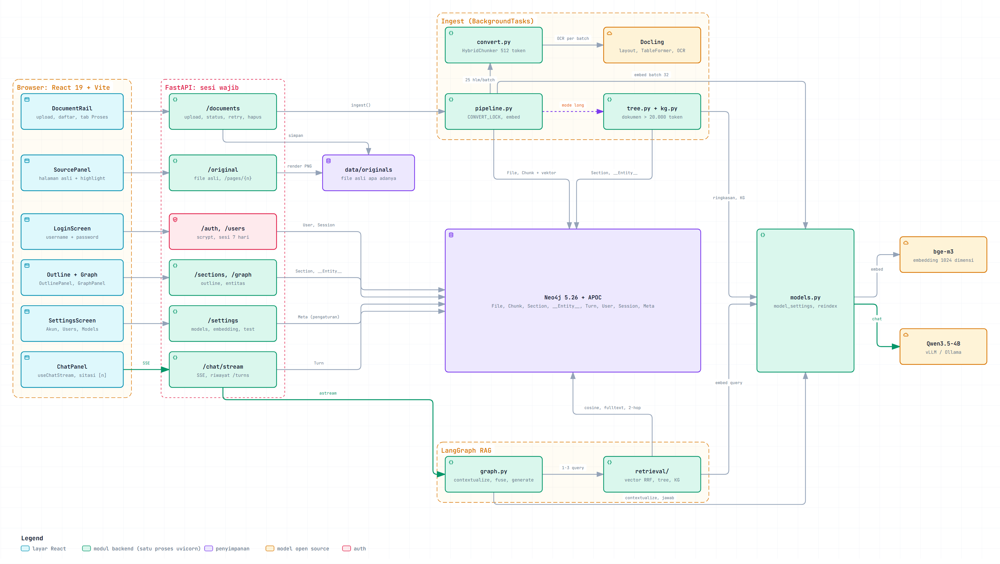
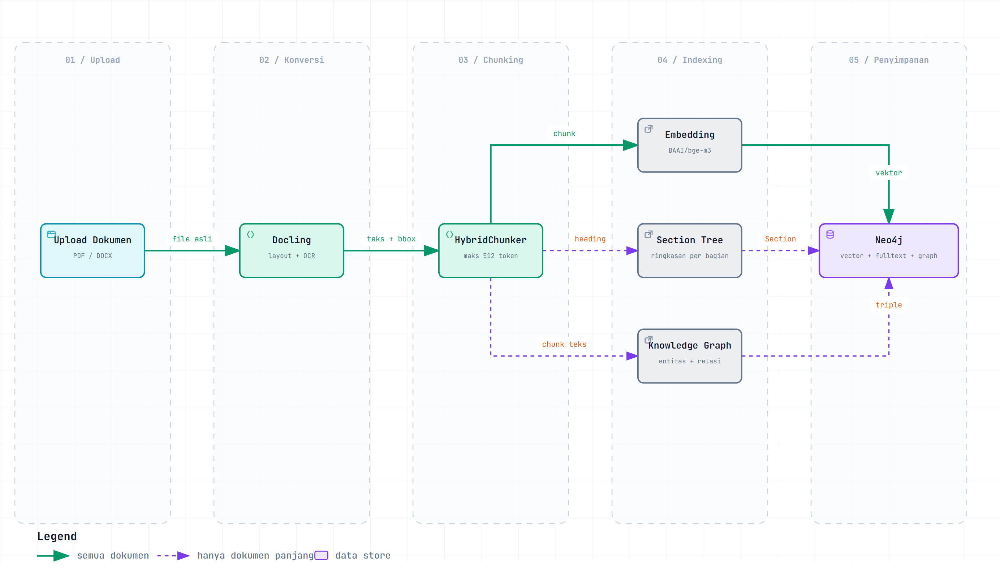
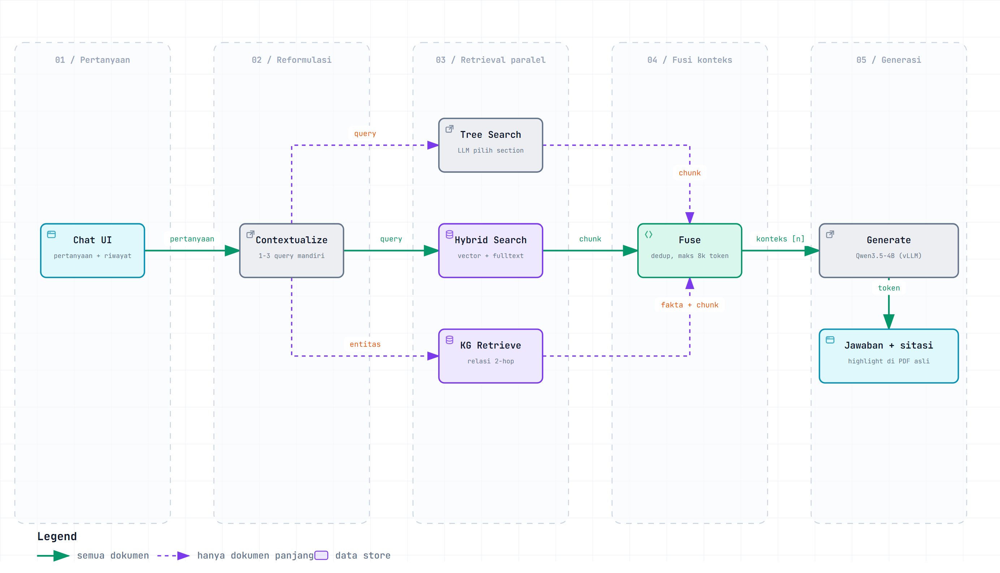

# Docs Analyzer: RAG Dokumen dengan Model Open Source

Tugas Besar Sertifikasi AI Super Class, track **Large Language Model (LLM)**.

- Penulis: Brillianta Zayyan Muhammad
- Repositori: https://github.com/zzayyan/xy-docs-analyzer

## 1. Ringkasan

Docs Analyzer adalah aplikasi Retrieval-Augmented Generation (RAG) untuk dokumen. Pengguna mengunggah
PDF atau DOCX, lalu bertanya tentang isinya dalam Bahasa Indonesia atau Inggris. Setiap jawaban
menyertakan sitasi bernomor `[n]`. Saat sitasi diklik, halaman asli dokumen terbuka dengan bagian yang
dikutip ditandai (highlight), sehingga jawaban bisa diperiksa langsung ke sumbernya.

Seluruh model di pipeline adalah model open source atau open weights: Qwen untuk menjawab, BAAI/bge-m3
untuk embedding, dan Docling untuk membaca layout dan OCR.

## 2. Masalah yang diselesaikan

Dokumen panjang seperti regulasi, kontrak, laporan tahunan, dan manual sulit dicari dengan pencarian
kata kunci biasa. Sebaliknya, chatbot LLM tanpa retrieval bisa mengarang jawaban. Docs Analyzer
menggabungkan keduanya:

1. Jawaban hanya disusun dari potongan dokumen yang ditemukan (grounded). Kalau konteksnya tidak
   memuat jawaban, model diminta mengatakannya.
2. Setiap klaim punya sitasi ke halaman dan posisi di dokumen asli.
3. Dokumen panjang mendapat struktur tambahan (outline bagian dan knowledge graph), sehingga pertanyaan
   tentang hubungan antar entitas atau isi satu bab tetap bisa dijawab.

## 3. Fitur

| Fitur | Keterangan |
|---|---|
| Tanya-jawab dengan sitasi | Jawaban di-stream token per token (SSE). Sitasi `[n]` membuka halaman asli dengan highlight. |
| Percakapan lanjutan | Pertanyaan seperti "jelaskan poin kedua" diubah menjadi query mandiri memakai riwayat percakapan. |
| Lintas bahasa | Bahasa dokumen dideteksi saat ingest. Pertanyaan diterjemahkan ke bahasa dokumen untuk pencarian, jawaban mengikuti bahasa pertanyaan. |
| Outline dokumen | Dokumen panjang punya pohon bagian (section tree) beserta ringkasan tiap bagian. |
| Knowledge graph | Entitas dan relasi dari dokumen panjang ditampilkan sebagai graph yang bisa dijelajahi. |
| Pilihan model | Admin bisa mengganti model chat dan model embedding dari halaman Settings. |
| Akun pengguna | Login dengan peran admin dan user biasa. |

## 4. Model open source yang dipakai

| Peran | Model | Cara dijalankan |
|---|---|---|
| Menjawab, reformulasi query, ringkasan bagian, ekstraksi knowledge graph | **Qwen3.5-4B-AWQ** (Alibaba Qwen, Apache 2.0) | vLLM, endpoint OpenAI-compatible |
| Alternatif lokal untuk peran di atas | **Qwen3 14B** | Ollama |
| Embedding (1024 dimensi) dan tokenizer chunking | **BAAI/bge-m3** (MIT) | Ollama atau server OpenAI-compatible |
| Konversi dokumen: layout, tabel, OCR | **Docling** (IBM, MIT) beserta model layout dan TableFormer-nya | Lokal, di dalam proses backend |

Penyedia model diatur lewat `backend/.env` (`LLM_PROVIDER`, `EMBED_PROVIDER`). Keduanya bisa `ollama`
atau `openai` (untuk vLLM, OpenRouter, dan server OpenAI-compatible lainnya), dan bisa diatur terpisah.
Contoh konfigurasinya ada di `backend/.env.example`.

## 5. Arsitektur

Stack yang dipakai:

- **Backend:** Python 3.12, FastAPI, LangGraph (orkestrasi alur RAG), LangChain (klien model)
- **Ingest:** Docling (konversi PDF/DOCX dan OCR), HybridChunker
- **Database:** Neo4j 5 untuk semua data: vektor, indeks fulltext, section tree, knowledge graph, dan
  riwayat percakapan
- **Frontend:** React, TypeScript, Vite

### 5.1 Arsitektur sistem



| Komponen | Kode | Peran |
|---|---|---|
| Web UI | `frontend/src/` | Upload, chat dengan sitasi, viewer halaman asli, outline, graph, Settings. Memanggil API dengan cookie sesi, jawaban dibaca lewat SSE. |
| FastAPI | `backend/app/api.py` | Semua endpoint REST dan stream SSE. Setiap request melewati cek sesi (`auth.require_user`), endpoint Settings dan Users hanya untuk admin. |
| Auth | `backend/app/auth.py` | Password di-hash dengan scrypt. Sesi berupa token acak di cookie HttpOnly, disimpan dalam bentuk hash di Neo4j, sehingga logout langsung memutus sesi. |
| Ingest | `backend/app/ingest/` | Jalan di `BackgroundTasks`. Konversi PDF dikunci satu per satu karena Docling butuh memori besar. Progres tiap tahap disimpan di node `File`. |
| LangGraph RAG | `backend/app/graph.py`, `backend/app/retrieval/` | Alur tanya-jawab (bagian 5.3). |
| Klien model | `backend/app/models.py`, `backend/app/model_settings.py` | Membuat klien Ollama atau OpenAI-compatible. Model yang diganti dari Settings disimpan di Neo4j dan langsung berlaku tanpa restart. Ganti model embedding memicu re-index di background (`backend/app/reindex.py`). |
| Neo4j 5.26 | `docker-compose.yml`, `backend/app/db.py` | Satu database untuk semua data: `File`, `Chunk` (embedding dan indeks fulltext), `Section`, `__Entity__`, `Turn` (riwayat chat), `User`, `Session`, dan `Meta` (pengaturan model). |
| File asli | `backend/data/originals/` | File yang diunggah disimpan apa adanya. Halaman PDF dirender ke gambar dengan pypdfium2 untuk highlight sitasi. |
| Model | Docling, bge-m3, Qwen | Lihat bagian 4. Docling berjalan di dalam proses backend, model lain diakses lewat HTTP. |

### 5.2 Alur ingest dokumen



1. **Upload.** File asli disimpan apa adanya supaya sitasi nanti bisa membuka halaman aslinya.
2. **Konversi (Docling).** Docling membaca layout, heading, dan tabel. Halaman hasil scan (tanpa lapisan
   teks) otomatis di-OCR. Keputusan OCR dibuat per batch 25 halaman, jadi PDF campuran (sebagian scan,
   sebagian teks digital) tetap terbaca utuh.
3. **Chunking.** HybridChunker memecah dokumen menjadi chunk maksimal 512 token (dihitung dengan
   tokenizer bge-m3). Setiap chunk menyimpan nomor halaman, heading induk, dan bounding box di halaman.
   Bounding box inilah yang dipakai untuk highlight.
4. **Embedding.** Setiap chunk di-embed dengan bge-m3, lalu disimpan ke Neo4j bersama indeks fulltext.
5. **Khusus dokumen panjang (lebih dari 20.000 token):**
   - **Section tree.** Outline dibangun dari heading dokumen. Setiap bagian diringkas oleh LLM.
   - **Knowledge graph.** `LLMGraphTransformer` mengekstrak entitas (orang, organisasi, lokasi, konsep,
     peristiwa, produk, regulasi, tanggal) dan relasinya dari setiap chunk.

### 5.3 Alur tanya-jawab



Alur ini adalah graph LangGraph di `backend/app/graph.py`:

1. **Contextualize.** Satu panggilan LLM mengubah pertanyaan menjadi 1 sampai 3 query pencarian yang
   berdiri sendiri. Kata ganti dan rujukan ke jawaban sebelumnya diselesaikan, pertanyaan perbandingan
   dipecah menjadi satu query per hal yang dibandingkan, dan query diterjemahkan ke bahasa dokumen.
2. **Retrieval paralel.**
   - **Hybrid search** (semua dokumen): cosine similarity bge-m3 dan pencarian fulltext Lucene,
     digabung dengan Reciprocal Rank Fusion (`1 / (60 + rank)`).
   - **Tree search** (dokumen panjang): LLM membaca outline beserta ringkasannya lalu memilih bagian
     yang relevan. Semua chunk di bagian itu ikut diambil.
   - **KG retrieve** (dokumen panjang): entitas di pertanyaan dicocokkan ke knowledge graph, relasi
     sampai 2 langkah diambil sebagai fakta, ditambah chunk yang menyebut entitas tersebut.
3. **Fuse.** Hasil ketiga retriever digabung, duplikat dibuang, dan konteks dibatasi 8.000 token.
4. **Generate.** Qwen menjawab hanya dari blok konteks bernomor dan mengutipnya sebagai `[n]`.
   Daftar sitasi dikirim ke browser sebelum token jawaban pertama, lalu jawaban di-stream lewat
   Server-Sent Events.

## 6. Endpoint API

Backend berjalan di `http://localhost:8000`. Dokumentasi interaktif (Swagger) tersedia di
`http://localhost:8000/docs`. Endpoint utama:

| Method | Path | Fungsi |
|---|---|---|
| `POST` | `/documents` | Upload dokumen dan mulai ingest di background |
| `GET` | `/documents/{doc_id}` | Status dan progres ingest |
| `GET` | `/chat/stream?doc_id=...&question=...` | Tanya-jawab, respons berupa stream SSE (`citations`, `token`, `done`) |
| `GET` | `/documents/{doc_id}/original/pages/{page_no}` | Gambar halaman asli untuk highlight sitasi |
| `GET` | `/documents/{doc_id}/sections` | Section tree dokumen panjang |
| `GET` | `/documents/{doc_id}/graph` | Knowledge graph dokumen panjang |
| `POST` | `/auth/login`, `/auth/logout` | Masuk dan keluar, sesi disimpan di cookie HttpOnly |
| `GET`, `PUT` | `/settings/models`, `/settings/embedding` | Mengganti model chat dan embedding (admin) |
| `GET`, `POST`, `PATCH`, `DELETE` | `/users` | Mengelola akun pengguna (admin) |

## 7. Cara menjalankan

Prasyarat: Docker, Python 3.12 dengan [uv](https://docs.astral.sh/uv/), Node.js, dan endpoint model
(Ollama lokal atau server vLLM).

```bash
# 1. Database
docker compose up -d

# 2. Model lokal (kalau memakai Ollama)
ollama pull qwen3:14b
ollama pull bge-m3

# 3. Backend
cd backend
cp .env.example .env    # isi LLM_*, EMBED_*, dan ADMIN_PASSWORD
uv sync
uv run uvicorn app.api:app --reload

# 4. Frontend (terminal lain)
cd frontend
npm install
npm run dev
```

Buka `http://localhost:5173`, login dengan akun admin dari `.env`, lalu upload dokumen.

## 8. Pengujian

```bash
cd backend
uv run pytest tests/ -q --ignore=tests/test_smoke.py --ignore=tests/test_models_live.py
```

Hasil terakhir: **111 test lulus**. Semua test ini berjalan tanpa model, dan hanya satu
(`test_users_and_sessions_in_neo4j`) yang membutuhkan Neo4j aktif.
`tests/test_smoke.py` menjalankan alur ingest dan tanya-jawab end to end, sehingga membutuhkan Neo4j
dan endpoint model yang aktif.

Keputusan desain penting dicatat sebagai ADR di [`docs/adr/`](adr/).

## 9. Keterbatasan

- Konversi PDF memakan waktu sekitar 10 sampai 20 detik per halaman, dan hanya satu PDF yang
  dikonversi pada satu waktu karena Docling membutuhkan memori besar.
- Upload dibatasi `MAX_UPLOAD_MB` (default 100 MB) dan `MAX_PAGES` (default 200 halaman).
- Model kecil seperti Qwen3.5-4B cepat, tetapi kadang kurang tepat untuk pertanyaan yang memerlukan
  penalaran panjang. Model bisa diganti dari Settings tanpa mengubah kode.
- Mengganti model embedding mengharuskan semua dokumen di-index ulang, karena vektor dari model yang
  berbeda tidak bisa dibandingkan.
